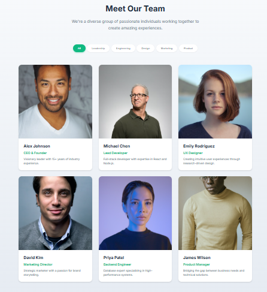

# Team Showcase

A reusable React 19 and TypeScript team component in Next.js 15 with category filters, responsive cards and Framer Motion interactions. All default profiles and biographies are fictional demonstration data.



The original screenshot is retained; contact controls are now visible without hover and generic social homepage links have been removed.

## Run locally

Use Node.js 22.19 or newer. Run `npm ci`, `npm run dev`, then visit http://localhost:3000. Production: `npm run build`, `npm start`. No API keys or backend are required.

## Configure the component

```tsx
import TeamSection from '@/components/team-section';
import {demoTeam} from '@/lib/team';
<TeamSection teamMembers={demoTeam} />
```

Records use unique numeric `id`, `name`, `role`, `department`, `bio`, `image` and optional `socials` entries (`twitter`, `linkedin`, `github`, `email`). Store local images in `public/`. Filter categories are derived from the supplied data; empty data shows a clear message. The selected button exposes `aria-pressed`, and a status announces the number of profiles shown. The sample email addresses use reserved `example.com`; replace all data with verified profiles before reuse.

Social controls are always visible and labelled with the member and service. Invalid/non-HTTPS URLs and credential-bearing URLs are omitted. External links use safe new-tab attributes. Missing images fall back to initials. Hover and keyboard focus apply the same subtle card interaction. Framer Motion's reduced-motion preference removes transforms and layout animation, with a CSS fallback disabling transitions. Profiles are visible before JavaScript hydration.

## Structure and checks

`app/` contains Next.js entry points and Tailwind styles. `components/team-section.tsx` handles filtering; `team-member.tsx` renders each card. `lib/team.ts` contains typed sample data, filtering and link validation. `public/` holds original assets. The independent HTML/CSS/JS prototype is preserved in `legacy/` and explicitly labelled as an archive.

Run `npm run typecheck`, `npm test`, and `npm run build`. Three test groups cover category filtering, derived departments and safe social links. CI installs the lockfile and checks types, tests and production build.

Unused generated modules/dependencies were removed. Framer Motion's previous floating `latest` dependency is pinned to registry version 14.0.0. Next.js is updated within major version 15 to 15.5.27 and PostCSS aligned to the patched direct version. Seven Tailwind 3 build-tool audit findings (five high, two moderate) remain documented; resolving them needs a tested upstream update or styling migration.

## Hosting and next steps

Use a Next.js-compatible host with `npm run build`; no verified public demo has been deployed. There is no profile database, CMS or real team directory. Future work could add search and custom category labels.

Author: Shazeel Ahmed. No license file is present.
